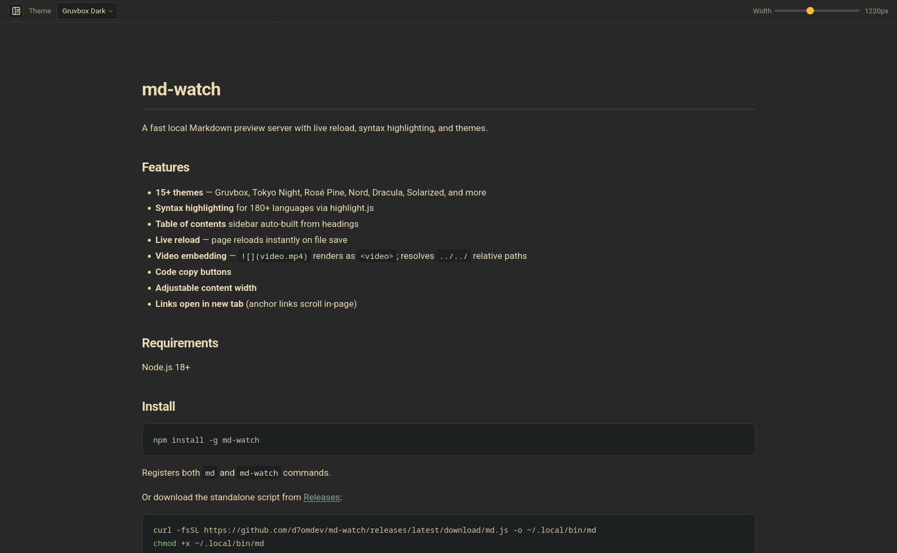

# md-watch

A fast local Markdown preview server with live reload, syntax highlighting, and themes.



## Features

- **15+ themes**: Gruvbox, Tokyo Night, Rosé Pine, Nord, Dracula, Solarized, and more
- **Syntax highlighting** for 180+ languages via highlight.js
- **Live reload**: the page updates in place on save and keeps your scroll position
- **Mermaid diagrams** that follow the current theme
- **Math** via KaTeX: `$inline$` and `$$display$$`
- **GitHub-style callouts** (`> [!NOTE]`, `> [!TIP]`, `> [!WARNING]`, …) and **footnotes**
- **Front matter** is stripped; the page title comes from the first `# heading`
- **Table of contents** sidebar built from headings
- **Files sidebar** listing `.md` / `.markdown` files in the current folder and two levels down
- **In-page navigation** between Markdown files, with working Back/Forward (scroll position kept) and `file.md#heading` links
- **Images and video**: `` renders as a `<video>`; `../` relative paths work
- **Code copy buttons** and **adjustable content width**
- **Local only by default**: binds to `127.0.0.1`

See [`examples/showcase.md`](examples/showcase.md) for every feature in one file.

## Requirements

Node.js 18+

## Install

```sh
npm install -g @d7om/md-watch
```

Registers both `md` and `md-watch` commands.

Or download the standalone script from [Releases](https://github.com/d7omdev/md-watch/releases/latest):

```sh
curl -fsSL https://github.com/d7omdev/md-watch/releases/latest/download/md.js -o ~/.local/bin/md
chmod +x ~/.local/bin/md
```

## Usage

```sh
md <file.md> [options]
```

Opens a live preview at `http://localhost:8123`.

| Option              | Description                                                        |
| ------------------- | ------------------------------------------------------------------ |
| `-p, --port <n>`    | Port to use. Default 8123, moving to the next free port if taken. `0` picks any free port |
| `--host <addr>`     | Address to bind. Default `127.0.0.1`; use `0.0.0.0` to share on your network |
| `-o, --open`        | Open the browser after starting                                    |
| `--exit-on-close`   | Stop the server when the browser tab is closed (or after 3 idle minutes if the browser crashes) |
| `-V, --version`     | Print version                                                      |
| `-h, --help`        | Show help                                                          |

```sh
md README.md                          # http://localhost:8123
md docs/index.md --port 3000 --open
md notes.md -p 0 -o --exit-on-close   # one-shot preview, e.g. from a file manager
```

### Open from Dolphin (KDE)

Save as `~/.local/share/kio/servicemenus/render-md.desktop` to get **Render md** in the right-click menu
for Markdown files:

```ini
[Desktop Entry]
Type=Service
MimeType=text/markdown;
Actions=renderMd

[Desktop Action renderMd]
Name=Render md
Icon=text-markdown
Exec=md %f -p 0 -o --exit-on-close
```

If `md` isn't on your desktop session's `PATH`, use its full path (for example `~/.bun/bin/md`).

## Build from source

```sh
bun install
bun run build         # outputs dist/md.js
bun test
```

## License

MIT © [d7om](mailto:hello@d7om.dev)
