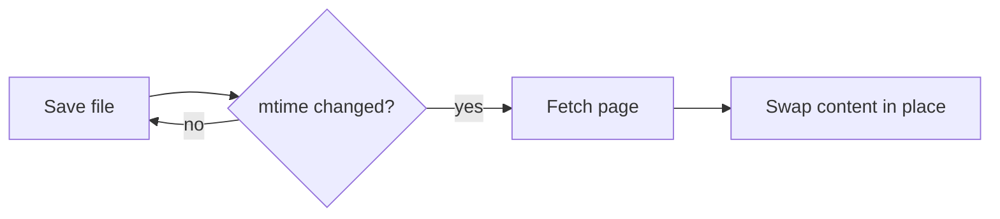
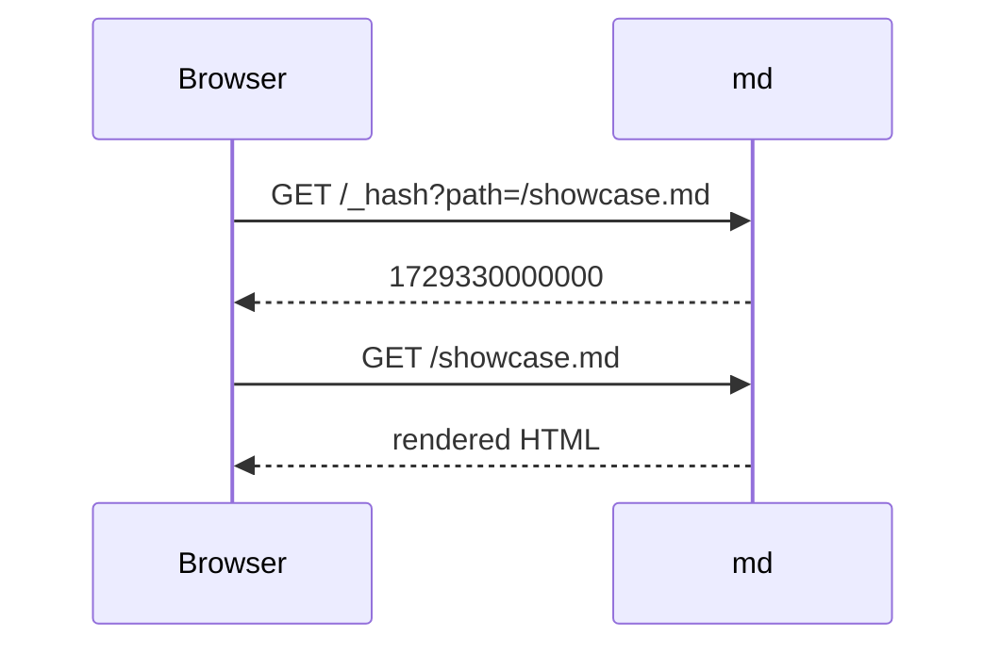

# md-watch Showcase

Every feature md-watch renders, in one file. Open it with:

```sh
md examples/showcase.md --open
```

Edit and save this file while it's open: the page updates in place and keeps your scroll position.

## Text formatting

Plain text with **bold**, *italic*, ***both***, ~~strikethrough~~, `inline code`, and a
[link to another section](#tables). External links like [GitHub](https://github.com) open in a
new tab.

Dollar patterns like `$&`, `` $` `` and `$'` inside code render exactly as written.

> A regular blockquote.
>
> > Nested inside another.

---

## Callouts

> [!NOTE]
> Useful information that users should know, even when skimming.

> [!TIP]
> Helpful advice for doing things better or more easily.

> [!IMPORTANT]
> Key information users need to know to achieve their goal.

> [!WARNING]
> Urgent info that needs immediate user attention to avoid problems.

> [!CAUTION]
> Advises about risks or negative outcomes of certain actions.

## Lists

- Unordered item
- Another item
  - Nested item
    - Deeper still
1. Ordered item
2. Second item
   1. Nested ordered

### Task list

- [x] Live reload
- [x] Themes
- [ ] Write more docs

## Tables

| Feature        | Shortcut      | Notes                       |
| :------------- | :-----------: | --------------------------: |
| Themes         | Theme menu    | 15+ themes, remembered      |
| Width          | Toolbar range | `∞` means full width        |
| Contents       | Left button   | Highlights current heading  |
| Files          | Right button  | `.md` files, two levels deep |

## Code

Every code block shows its language and a **Copy** button.

```ts
import { startServer } from "./server";

const { port } = await startServer({ entryFile: "README.md", port: 0 });
console.log(`Serving http://localhost:${port}`);
```

```python
def fib(n: int) -> int:
    return n if n < 2 else fib(n - 1) + fib(n - 2)
```

```bash
# a shell comment does not become the page title
md notes.md -p 0 -o --exit-on-close
```

```diff
- old line
+ new line
```

```rust
fn main() {
    println!("Hello from Rust");
}
```

```json
{ "name": "@d7om/md-watch", "bin": { "md": "dist/md.js" } }
```

```html
<p class="note">HTML gets its own mark, even though it highlights as XML.</p>
```

```
Code block with no language: no highlighting, still copyable.
```

## Diagrams

Mermaid diagrams render with colours that follow the current theme. Switch themes to see them
update.





## Math

Inline math like $e^{i\pi} + 1 = 0$ sits in a sentence. Display math gets its own line:

$$
\int_{-\infty}^{\infty} e^{-x^2}\,dx = \sqrt{\pi}
$$

$$
\begin{aligned}
  \nabla \cdot \mathbf{E} &= \frac{\rho}{\varepsilon_0} \\
  \nabla \times \mathbf{B} &= \mu_0 \mathbf{J} + \mu_0 \varepsilon_0 \frac{\partial \mathbf{E}}{\partial t}
\end{aligned}
$$

## Footnotes

md-watch supports footnotes[^1], and they can hold longer notes too[^long].

[^1]: Rendered at the bottom of the page, with a back-link.
[^long]: Footnotes can contain `code` and **formatting**.

## Images and video

Relative paths work, including ones that climb out of the folder with `../`:


Video files (`.mp4`, `.webm`, `.mov`, `.mkv`, `.ogg`) use the same syntax as images and render as a
player. This clip is ``:


## Navigation

- [Getting started guide](guides/getting-started.md) opens without a full page reload.
- [Jump to a heading in another file](guides/getting-started.md#flags) scrolls to it after
  loading.
- Browser **Back** and **Forward** work across files.
- Ctrl/Cmd-click opens the link in a new tab as usual.
- Hover any heading and click `#` to copy a link to it.

## Headings

### Third level

#### Fourth level

Headings down to level four appear in the contents sidebar.

## HTML

<details>
<summary>Raw HTML works too (click to expand)</summary>

You can use <kbd>Ctrl</kbd> + <kbd>C</kbd>, <mark>highlighted text</mark>, and other inline HTML.

</details>
